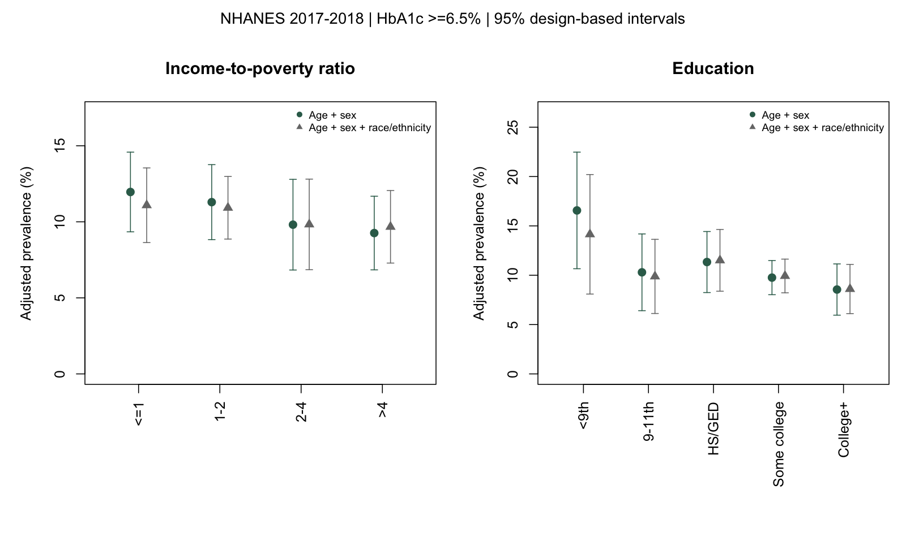

# Population Health & Disparities Analysis

**An exploratory epidemiologic analysis of socioeconomic characteristics and diabetes-range HbA1c among U.S. adults.**

This portfolio project uses public CDC NHANES 2017-2018 demographic and glycohemoglobin data to examine whether income-to-poverty ratio and educational attainment are associated with measured HbA1c >=6.5%. It includes reproducible data preparation, complex-survey weighted estimation, regression modeling, marginal standardization, sensitivity analysis and a research report.

**Research status:** Analyses and an integrated working report exist; external scientific/editorial review and nonresponse sensitivity remain pending; two adjustment specifications are shown in parallel. Reported associations are observational, not causal.

## Research question
How are income and education associated with diabetes-range HbA1c prevalence among U.S. adults aged 20 years or older?

## Study at a glance
- NHANES 2017-2018, two-year survey cycle.
- 9,254 survey respondents in the all-age merged source, 5,569 adults 20+ and 4,362 complete cases in the adjusted regression analysis.
- Outcome: HbA1c >=6.5%, a laboratory threshold rather than confirmed clinical diabetes.
- Main explanatory variables: income-to-poverty ratio and education.
- Methods: R `survey` package, complex-survey weights/strata/PSUs, adjusted logistic regression and design-covariance-aware standardized prevalence.

## Selected findings (exploratory)
- Weighted HbA1c >=6.5% prevalence varied from 20.28% among adults with less than ninth-grade education to 8.72% among college graduates and above, before adjustment.
- The selected college+ versus less-than-ninth-grade standardized contrast was -8.02 percentage points (95% CI -14.46 to -1.58) after age/sex adjustment and -5.54 points (95% CI -11.96 to 0.88) when additionally adjusted for race/ethnicity.
- Exploratory extreme-category assignments for missing income produced a highest-versus-lowest income contrast of -2.03 to -2.71 percentage points with age/sex adjustment and -0.85 to -1.70 points with extended demographic adjustment. These are assumption stress tests, not definitive bias correction.



*Figure: survey-standardized prevalence of HbA1c >=6.5% by income and education under two adjustment strategies. Error bars represent approximate design-based 95% confidence intervals. Complete-case analytic sample, n=4,362.*

## Reproduce locally
Prerequisites: Python 3 with `pandas`, R with the `survey` package, and internet access for the initial public NHANES data download (or the original XPT files placed in `data/raw/`).

```sh
python3 -m venv .venv
.venv/bin/python -m pip install pandas
Rscript -e 'if (!requireNamespace("survey", quietly=TRUE)) install.packages("survey", repos="https://cloud.r-project.org")'
.venv/bin/python scripts/01_download_and_audit.py
./scripts/17_reproducibility_audit.sh
```

The audit rebuilds the full-age survey source from retained XPT files, reruns model checks and recreates comparison outputs. An isolated-folder reproducibility check passed on the original Mac with a fresh Python virtual environment; an independent second-computer test has not been performed.

## Key project files
| Location | Content |
|---|---|
| `scripts/01_download_and_audit.py` | Official XPT acquisition, adult merge and audit |
| `scripts/13_build_full_survey.py` | Reconstruct all-age NHANES analytic source |
| `scripts/14_model_replication.R` | Verify adjusted model and marginal replication |
| `scripts/15_reliability_and_model_decision.R` | Subgroup reliability and model inference comparison |
| `scripts/16_model_comparison_figures.R` | Generate adjusted figures and tables |
| `scripts/17_reproducibility_audit.sh` | Local reproducibility entrypoint |
| `reports/17_integrated_research_report.md` | Integrated research report (working draft) |
| `PROJECT_CHECKLIST.md` | Live project progress and outstanding publication gates |

## Responsible interpretation
This is a cross-sectional analysis. Covariate selection influences adjusted findings; the extended model has limited residual survey degrees of freedom for some omnibus tests. Complete-case exclusions, especially missing income data, may cause selection bias. No result should be read as a causal effect or individual medical diagnosis.

## Data and provenance
Source: US National Center for Health Statistics, CDC, NHANES 2017-2018.
- [Demographic file (DEMO_J)](https://wwwn.cdc.gov/nchs/data/nhanes/public/2017/datafiles/DEMO_J.htm)
- [Glycohemoglobin file (GHB_J)](https://wwwn.cdc.gov/Nchs/Data/Nhanes/Public/2017/DataFiles/GHB_J.htm)
- [NHANES analytic guidance](https://wwwn.cdc.gov/nchs/nhanes/analyticguidelines.aspx)

The project's `.gitignore` excludes raw/processed respondent-level source files and virtual environments from Git. The included figure and aggregate tables contain no respondent-level identifiers.
